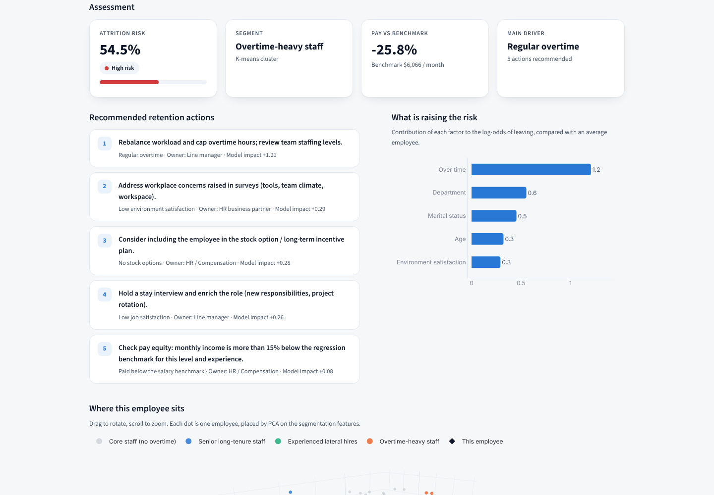
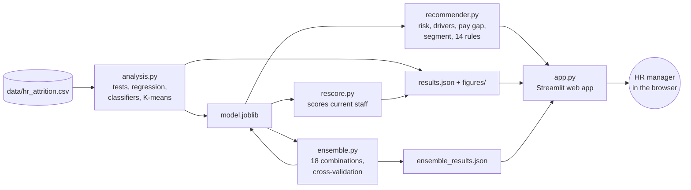
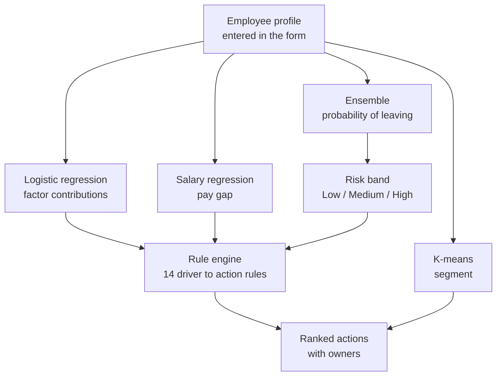

# Employee Retention Recommender

A Streamlit web app that estimates each employee's risk of leaving, shows what is driving that risk, and recommends retention actions ranked by priority. It was built for the BMGT107L Business Analytics project on the IBM HR Analytics Employee Attrition dataset (1,470 employees, 16.1% attrition).

**Live app:** add your Streamlit Cloud link here



## What it does

- **Risk score.** A soft-voting ensemble (logistic regression, LDA, SVM and gradient boosting) gives the probability of leaving and a Low, Medium or High band. It was picked from 18 model combinations by 5-fold cross-validation and scores a test AUC of 0.812.
- **Drivers.** Logistic regression shows how much each factor, such as overtime or years since promotion, raises this employee's risk.
- **Pay check.** A multiple linear regression benchmark compares the employee's pay with what their level and experience predict.
- **Segment.** K-means places the employee in one of four workforce segments.
- **Actions.** 14 rules link each significant driver to an action and an owner, ranked by priority and by the model's impact for that person.

The app has four tabs: Assess an employee, Workforce overview, 3D workforce map and Model insights.

## Architecture



The three scripts on the left run once, offline. They train the models and save them to `model.joblib`, plus the numbers and charts the app shows. The deployed app only loads these saved files, so it starts quickly and needs no training on the server.



## Project structure

```
.
├── app.py                    Streamlit web app
├── recommender.py            cleaning, action rules and recommendation logic
├── analysis.py               statistical analysis; writes figures/, results.json, model.joblib
├── ensemble.py               compares 18 model combinations; adds the ensemble to model.joblib
├── rescore.py                re-scores staff with the ensemble; updates results.json
├── build_reports.py          builds the DA reports (Word)
├── model.joblib              trained models used by the app
├── results.json              analysis results shown in the app
├── ensemble_results.json     model comparison shown in the app
├── data/hr_attrition.csv     dataset
├── figures/                  charts from the analysis
├── screenshots/              app screenshots
├── .streamlit/config.toml    app theme
├── requirements.txt          packages for the app (used when deploying)
└── requirements-analysis.txt extra packages to re-run the analysis
```

## Run it locally

You need Python 3.11, 3.12 or 3.13.

```bash
python -m venv .venv
# Windows
.venv\Scripts\activate
# Mac / Linux
source .venv/bin/activate

pip install -r requirements.txt
streamlit run app.py
```

The app opens at http://localhost:8501.

To re-run the full analysis and retrain the models, install the extra packages and run the scripts in this order:

```bash
pip install -r requirements-analysis.txt
python analysis.py
python ensemble.py
python rescore.py
```

## Deploy on Streamlit Community Cloud

1. Push this folder to a public GitHub repository.
2. Go to https://share.streamlit.io, sign in with GitHub and click **Create app**.
3. Pick the repository, branch `main` and main file `app.py`. Under **Advanced settings**, choose Python 3.12.
4. Click **Deploy**. Streamlit installs `requirements.txt` and gives you a link such as `https://your-app-name.streamlit.app`.

## Model results

| Model | CV AUC | Test AUC |
|---|---|---|
| Soft voting: LR + LDA + SVM + gradient boosting (deployed) | 0.845 | 0.812 |
| Logistic regression + engineered features | 0.843 | 0.810 |
| Logistic regression (baseline) | 0.839 | 0.808 |
| Random forest | 0.809 | 0.752 |

The test AUC's 95% bootstrap interval is 0.75 to 0.88. Tree models such as random forest score close to 1.00 on their own training data but much lower on new employees, so they were not chosen.

## Data

IBM HR Analytics Employee Attrition & Performance, Kaggle: https://www.kaggle.com/datasets/pavansubhasht/ibm-hr-analytics-attrition-dataset. The data is fictional, created by IBM data scientists.
